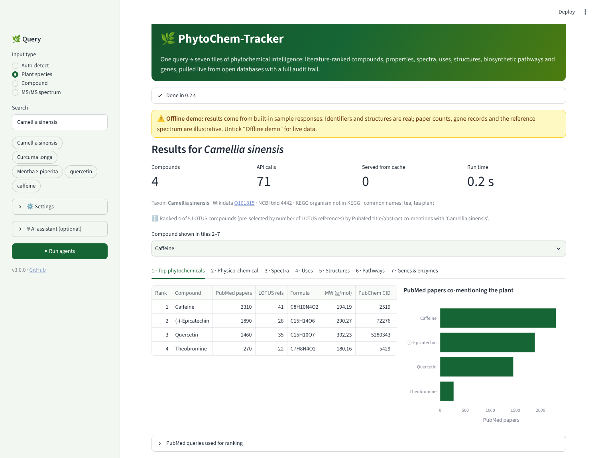
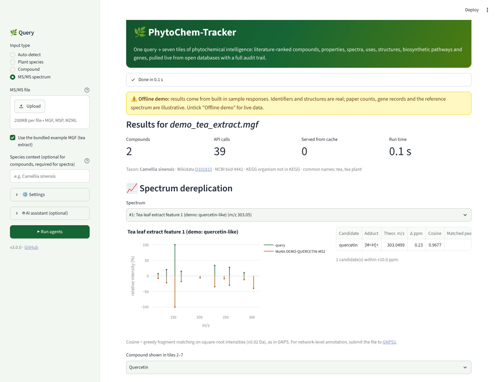

# 🌿 PhytoChem-Tracker v3

**An agentic web dashboard that turns one query — a plant species, a compound, or an MS/MS spectrum file — into a seven-tile phytochemical report built from live, citable databases.**

Natural-products chemists routinely consult dozens of resources to characterise a single compound. PhytoChem-Tracker orchestrates those look-ups: a router decides what kind of input it received, specialised agents query each database in parallel (respecting their rate limits), and the results are merged into one dashboard with a full audit trail.



| Tile | What it shows | Live sources |
|---|---|---|
| 1 · Top phytochemicals | Compounds reported in the plant, ranked by PubMed papers that mention compound **and** plant | LOTUS (via Wikidata), PubMed E-utilities |
| 2 · Physico-chemical | MW, formula, XLogP, TPSA, H-bond counts; experimental melting/boiling point, solubility, physical form with original sources; local RDKit descriptors | PubChem PUG-REST & PUG-View, RDKit |
| 3 · Spectra | Available MS, MS/MS, NMR, IR, UV-Vis records; MoNA reference MS/MS spectra plotted; links to MassBank, GNPS, NP-MRD, NIST WebBook | PubChem, MoNA |
| 4 · Uses | Therapeutic, pharmacological-class, agricultural/veterinary and industrial uses | PubChem annotations (HSDB, MeSH, …); links to IMPPAT, Dr. Duke's |
| 5 · Structures | 2D depiction, interactive 3D viewer, SDF/MOL/SMILES downloads | PubChem 3D conformers, RDKit |
| 6 · Biosynthetic pathways | KEGG maps containing the compound (species-specific where KEGG has the genome), enzymes (EC) acting on it | KEGG REST; links to PlantCyc, Plant Reactome |
| 7 · Genes & enzymes | EC numbers mapped to gene/protein IDs in the chosen plant | KEGG GENES, UniProt; link to Phytozome |

Exports: full JSON (with audit log), zipped CSV tables + SDF, and a PDF summary.

---

## Three ways to query

1. **Plant species** — `Camellia sinensis`, `Mentha × piperita`, or a common name such as `tea`
   (resolved through Wikidata; an optional LLM can help with harder common names).
2. **Compound** — name, SMILES, InChI or InChIKey. Tile 1 then lists the organisms the compound
   is reported in. Add a *species context* to map its enzymes to that plant's genes.
3. **MS/MS spectrum** — upload MGF, MSP or mzML plus a species context. Each precursor m/z is
   matched against every compound known from that plant (common ESI adducts, ppm tolerance),
   and the best candidates are scored against MoNA reference spectra with a GNPS-style cosine.

   

**Shareable links:** results can be bookmarked or sent to colleagues, e.g.
`https://<your-app>/?q=Curcuma+longa&mode=species&run=1`.

---

## Quick start

```bash
git clone https://github.com/rpwdoc2025/PhytoChem-Tracker.git
cd PhytoChem-Tracker
python -m venv .venv && source .venv/bin/activate      # Windows: .venv\Scripts\activate
pip install -r requirements.txt
streamlit run app.py                                      # opens http://localhost:8501
```

* No API keys are required.
* Tick **Settings → Offline demo** to try the whole interface without network access
  (built-in sample responses; values marked as illustrative).
* The first live query for a plant takes roughly 30–90 s because the agents stay within each
  database's request budget (e.g. PubMed allows 3 requests/s without a key). Results are cached
  locally for 72 h, so repeat queries return in seconds.

### Verify the live connections

```bash
python scripts/live_smoke_test.py          # one PASS/FAIL line per database
python scripts/live_smoke_test.py --full   # plus an end-to-end species query
```

Run this first on a new machine, and again if a tile ever comes back empty: databases
occasionally change their APIs, and this pinpoints which one.

### Optional settings (`.streamlit/secrets.toml` or environment variables)

See [`.streamlit/secrets.toml.example`](.streamlit/secrets.toml.example).

| Setting | Effect |
|---|---|
| `NCBI_API_KEY`, `NCBI_EMAIL` | Faster PubMed ranking (10 instead of 3 requests/s) |
| `PCT_LLM_PROVIDER` = `anthropic` / `openai` / `gemini` + matching `*_API_KEY` | Enables the AI summary and common-name resolution |
| `PCT_CACHE_DIR` | Where the SQLite cache and audit logs are stored |
| `PCT_<NAME>_BASE` (e.g. `PCT_PUBCHEM_BASE`) | Point a connector at a mirror |

---

## Deploy

**Streamlit Community Cloud (free):** sign in at <https://share.streamlit.io> with GitHub →
*Create app* → repository `rpwdoc2025/PhytoChem-Tracker`, branch `main`, file `app.py` → *Deploy*.
Add any keys under *App settings → Secrets*.

**Docker:**

```bash
docker build -t phytochem-tracker .
docker run -p 8501:8501 -v pct-data:/data phytochem-tracker
```

---

## How it works

```
input ─► Router agent ─┬─ species  ─► Taxonomy agent (Wikidata) ─► Literature agent (LOTUS + PubMed ranking)
                       ├─ compound ─► Resolver agent (PubChem)  ─► LOTUS occurrences
                       └─ spectrum ─► parse ─► precursor matching (RDKit masses) ─► MoNA cosine
                                         │
                   per compound, in parallel ▼
      PhysChem · Spectral · Uses · Structure · Pathway agents ─► Gene agent ─► (optional) LLM summary
```

* **Deterministic orchestration.** The control flow is plain, logged Python, so every run is
  reproducible. The audit log records each routing decision and every HTTP call (URL, status,
  cache hit, timing).
* **No hallucinated data.** Every number in the tiles comes from a database response or an RDKit
  calculation. The optional LLM only writes a summary from the retrieved JSON (instructed to add
  nothing) and suggests binomials for common names, which are then verified on Wikidata.
* **Resilience.** Per-host rate limiting, retries with exponential backoff, a 72 h SQLite cache
  that also serves stale data if a database is down, and agents that record failures per tile
  instead of crashing the report.

More detail, including the ranking method and its limitations, is in
[docs/ARCHITECTURE.md](docs/ARCHITECTURE.md).

## Development

```bash
pip install -r requirements-dev.txt
python -m pytest -q        # 40 tests, fully offline (fixture responses), ~5 s
```

GitHub Actions runs the same suite on Python 3.11 and 3.12 for every push.

```
app.py                       Streamlit UI (7 tiles, exports, audit view)
phytochem_tracker/
  orchestrator.py            routing + parallel agent dispatch
  agents.py                  the seven tile agents
  router.py                  input-type detection
  connectors/                pubchem, pubmed, wikidata (LOTUS), kegg, uniprot, mona, links
  chem.py  spectra.py        RDKit utilities; MGF/MSP/mzML parsing, adducts, cosine
  http.py  audit.py          cached/rate-limited HTTP client; JSONL audit log
  llm.py   report.py         optional Claude/GPT/Gemini layer; JSON/CSV/PDF exports
  demo.py                    offline fixtures (demo mode and tests)
scripts/live_smoke_test.py   live API checks
```

## Earlier versions

`PhytoChem-Tracker.ipynb` (v1, Colab) is kept for reference; it demonstrates the interface with
mock data. [](https://colab.research.google.com/github/rpwdoc2025/PhytoChem-Tracker/blob/main/PhytoChem-Tracker.ipynb)

## Data sources and citation

Please cite the underlying resources when using results: LOTUS (Rutz et al., *eLife* 2022),
PubChem (Kim et al., *NAR* 2025), KEGG (Kanehisa et al.), UniProt (UniProt Consortium),
MassBank of North America, RDKit. KEGG REST is free for academic use; see each provider's terms.

*PhytoChem-Tracker was designed by Robert Weinberg (CS 5047 final project, Northeastern University).*
